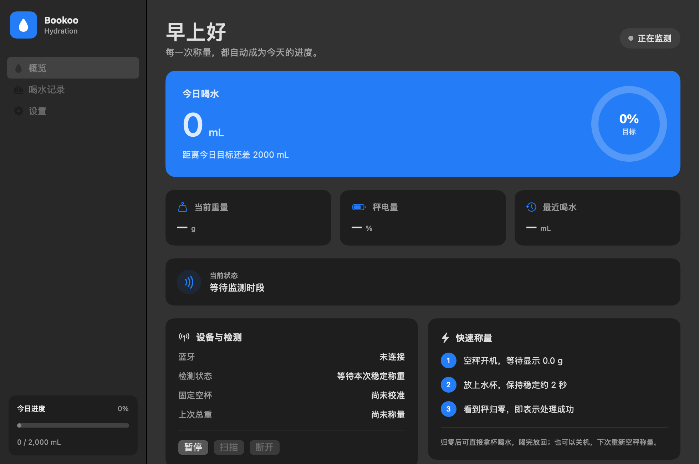
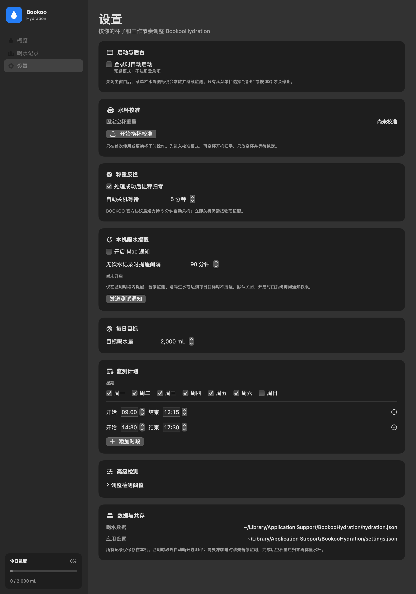

# BookooHydration

一个独立的 macOS 菜单栏饮水记录器：蓝牙连接 BOOKOO 咖啡秤，按喝水前后的杯重差记录饮水量，并在 **Mac 本机**提醒喝水。

开箱即用的 Mac 本地记录与提醒，不需要服务器或云服务；不上传饮水记录、不包含遥测。你也可以基于本地数据与提醒逻辑，自行扩展到手机、手表或其他设备提醒。它不是 BOOKOO 官方软件。

## 界面预览

以下为隔离预览模式的空记录界面，不含个人数据。



<details>
<summary>查看设置与本机提醒</summary>



</details>

## 系统与设备

- macOS 13 或更高版本；发布包为 Universal（arm64 + x86_64）；x86_64 已运行隔离 UI 测试，arm64 已交叉编译，尚未实机运行。
- BOOKOO Ultra 协议咖啡秤，要求服务 `0x0FFE`、通知 `FF11`、带响应写入 `FF12`。基于 Themis Ultra 的称重实现，当前发布尚未完成真秤验收；其他型号不承诺兼容。
- 自动排除 MT80/MOTTO80 磨豆机、压力监测器；仅发现品牌名并不算连接成功。
- 同一台秤不要同时由本程序与其他咖啡 App 控制。

## 安装

从本仓库 Releases 下载 `BookooHydration-standalone-1.0.0-macos-universal.zip`，解压后将 **BookooHydrationStandalone.app** 放入“应用程序”。

当前为本地临时签名，**没有 Apple Developer ID 签名或公证**。macOS 可能阻止首次打开；确认来源后按系统提示在“隐私与安全性”中允许。无需关闭系统安全保护。

首次运行会请求蓝牙权限。程序只显示菜单栏水滴，不显示 Dock 图标；点击“记录与设置…”打开完整窗口。

- 登录启动默认关闭，可在“设置 → 启动与后台”自行开启。
- 喝水提醒默认关闭，可在“设置 → 本机喝水提醒”开启；此时才请求系统通知权限。
- 饮水记录、杯重与提醒设置保存在本机，不需要登录账号。

## 首次使用与换杯

1. 在“设置 → 水杯校准”点击“开始换杯校准”。
2. 保持秤面为空，手动开秤并等待 `0.0 g`，使用普通称重模式。
3. 只放空杯，稳定约 2 秒后保存空杯重量；成功后秤归零确认。
4. 换杯时重新校准，历史记录保留。

## 每天怎么用

1. 装水后，**空秤开机归零，再放装好水的杯子**。首次称量保存杯＋水总重，不记喝水。
2. 喝水后再称：杯重减少默认 10–500 g 时，按 `1 g ≈ 1 mL` 记录。
3. 加水只更新总重；小幅波动、异常大幅下降、低于空杯重量不会算作喝水。
4. 处理成功后自动去皮。可在同一次开机中拿杯、喝水、放回，也可关机后空秤重启再称。

不需要让杯子一直放在秤上；不要把杯子放在秤上再开机，否则杯重会被当成零点。秤关机后必须手动开机，蓝牙不能远程唤醒。官方自动关机范围为 5–30 分钟，立即关机仍使用物理按键。

默认监测计划：周一至周六 09:00–12:15、14:30–17:30，可自行修改。时段外断开蓝牙。需要冲咖啡时先暂停本程序；完成后空秤重启归零，再称原水杯。程序不会跨应用抢占设备或自动交接。

## 本机通知规则

- 默认关闭；开启后按设置的 15–240 分钟间隔（默认 90 分钟）判断是否长时间未记录喝水。
- 仅在监测计划内提醒，提醒与称重共用星期和时段。
- 开启提醒、每个监测时段开始、最近一次饮水、最近一次提醒，均会提供完整间隔的宽限。
- 暂停监测、当天达到目标、刚记录喝水时不提醒。秤离线不阻止提醒。
- 电脑睡眠期间不会唤醒电脑补发；恢复后重新检查当前条件，不补发多条积压通知。
- 冷却时间先写入磁盘再提交通知，避免崩溃后重复轰炸；提交失败也保守等待一个间隔。
- 通知依赖 macOS 的权限、专注模式及通知样式。“发送测试通知”不会添加饮水记录。

“本机通知已提交”不代表系统一定显示了横幅；可在系统设置中允许通知并检查专注模式。应用退出后不再提醒。

## 扩展到其他设备提醒

内置功能是 **Mac 本机通知**。如果希望在手机、手表、其他电脑或家庭设备上提醒，可以自行开发扩展，例如：

- 用自建脚本只读读取 `hydration.json`，根据当天进度和最近饮水时间，通过自己选择的通知服务推送。
- 在 `ReminderPolicy.swift` 的提醒条件与 `LocalNotifications.swift` 的通知实现基础上，接入其他设备或自建通知接口；扩展时应保留时段、暂停与冷却规则。
- 由自建的接收端展示进度、播放声音或发送设备通知。

**这些是扩展方向，并非已经内置的跨设备功能。** 当前没有提供 Webhook、手机端、手表端或现成的跨设备桥接；相关服务、鉴权、调度与设备端需要自行实现和配置。外部程序应只读饮水数据，不与应用同时写入记录；不要在公开仓库提交推送凭据或私人设备地址。

## 数据与隐私

所有运行数据保存在：

```text
~/Library/Application Support/BookooHydration/
  hydration.json          饮水历史、目标及上次总重
  settings.json           杯重、监测计划及提醒设置
  reminder-state.json     本机提醒冷却时间
  bluetooth-status.json   本机蓝牙诊断（含设备标识，不上传）
```

程序是这些文件的唯一写入者，保存采用原子替换。饮水文件损坏时先备份，备份失败则停止写入；提醒状态文件损坏时停止自动提醒，不静默重置冷却。退出程序后可手动备份上述目录。卸载应用不会删除历史；需要彻底移除时由用户自行删除该目录。

仅用于个人饮水习惯辅助，不是医疗工具；称重无法区分喝水、倒水或洒水，误记录可在应用里撤销最新一笔。每日目标是可修改的软件默认值，不是个体健康建议。

## 从源码构建

需要 Apple Command Line Tools（SwiftPM），不需要完整 Xcode，也没有第三方包依赖。

```bash
./scripts/run_tests.sh
./scripts/build_app.sh --universal
python3 scripts/smoke_test.py
```

产物：`build/BookooHydrationStandalone.app`。脚本只构建，不自动安装或启动应用；不包含私钥。不带 `--universal` 时仅构建本机架构，测试不连接真实蓝牙设备。

`scripts/smoke_test.py` 在隔离目录、禁用蓝牙/通知/登录注册的预览模式下后台渲染三个界面，不抢占前台。预览图不是实机称重或通知横幅验收。

开发测试可用 `BOOKOO_DATA_ROOT` 指向隔离数据目录；预览必须同时设置 `BOOKOO_PREVIEW=1` 和隔离目录。普通运行无需环境变量。

## 验证与限制

- 自动断言覆盖称重解析、检测、JSON 持久化、设备识别、时段边界、本地提醒策略及旧设置兼容。
- 本地 Release 编译、临时签名与 UI 预览可自动验证。
- 当前发布的实际蓝牙称量、用户授予通知权限后的通知横幅，以及 Apple Silicon 运行情况仍需实机验收；不能用单元测试代替。

## 权利与来源

此仓库保留现有 BookooHydration 实现与图标生成代码。BOOKOO 名称及设备商标归相关权利人所有，不表示官方认可。没有外部包依赖。

尚未指定开源许可证；上传 GitHub 不等于授权自由再分发或授予 BOOKOO 商标使用权。公开开源前需由项目所有者确定许可证并确认图标等资源权利。
